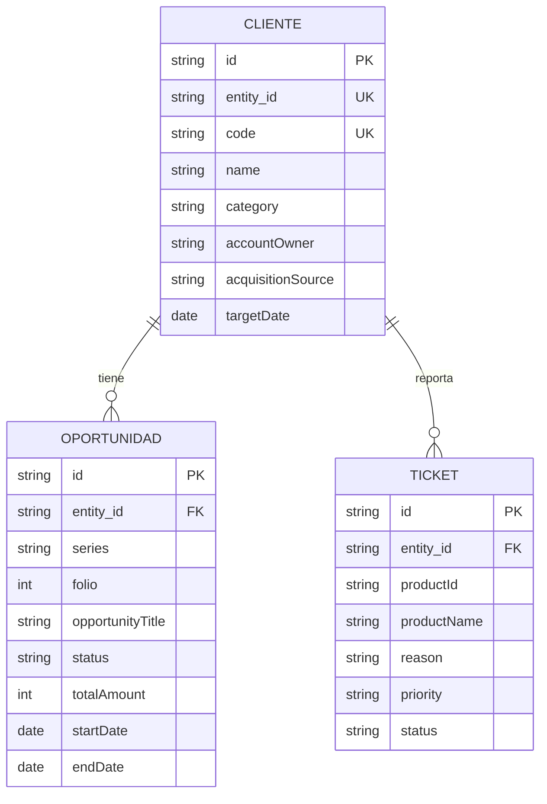

# Modelo de datos: módulo CRM

**Fecha**: 2026-11-03 · **Especificación**: [spec.md](spec.md) · **Plan**: [plan.md](plan.md)

## Decisión de adaptación

Se mantienen dos colecciones base: `Entity` representa **Cliente** y `Document` representa **Oportunidad**. Los nombres internos existentes permanecen estables. `ModuleConfig` es configuración estática; responsables, tipos, orígenes y prioridades son catálogos en esa configuración, sin una tercera tabla.

No se usa una tabla separada de contactos: cada cliente tiene **un contacto principal** (`contactName`, `email`, `phone`). Múltiples contactos y actividades son extensiones futuras. Los tickets de soporte son P2 y agregan una colección propia, `Ticket`, que referencia al cliente por `entity_id` y al producto por una clave externa.

## Entidad: Cliente (`Entity`)

| Campo | Tipo | Significado CRM | Restricción |
|---|---|---|---|
| `id` | string | Identificador interno | Generado, único, inmutable |
| `entity_id` | string | Identificador público para vinculación | Generado, único, inmutable; no es `code` ni RUT |
| `name` | string | Nombre o razón social | Obligatorio, recortado, no vacío |
| `code` | string | Código de cliente | Obligatorio; único tras `trim` y mayúsculas |
| `taxId` | string | Identificación fiscal | Base opcional; no requerida en demo |
| `email` | string | Correo del contacto principal | Opcional; formato válido si existe |
| `phone` | string | Teléfono del contacto principal | Opcional, recortado |
| `address` | string | Dirección | Base opcional; no se solicita en el formulario CRM |
| `category` | string | Tipo de cliente | Obligatorio CRM: Prospecto, Activo, Inactivo |
| `description` | string | Contexto de la relación comercial | Opcional; texto seguro |
| `targetDate` | string | Próximo contacto | Opcional, fecha real `YYYY-MM-DD` |
| `creditLimit` | number | Límite de crédito | Base opcional ≥ 0; no se usa para priorización CRM |
| `paymentTerms` | string | Condiciones de pago | Base opcional, fuera del formulario CRM |
| `contactName` | string | Nombre del contacto principal | Personalizado, opcional |
| `accountOwner` | string | Ejecutivo responsable | Personalizado, obligatorio, catálogo |
| `acquisitionSource` | string | Origen de captación | Personalizado, obligatorio, catálogo |
| `createdAt` | string | Creación | ISO 8601, generado |
| `updatedAt` | string | Última modificación | ISO 8601, actualizado al guardar |

Se omiten del formulario CRM los campos comerciales base no necesarios, pero no se borran de registros existentes ni se reutilizan con otro significado. Si el template no permite ocultarlos desde configuración, se ajusta la presentación sin cambiar el esquema.

## Entidad: Oportunidad (`Document`)

| Campo | Tipo | Significado CRM | Restricción |
|---|---|---|---|
| `id` | string | Identificador interno | Generado, único, inmutable |
| `entity_id` | string | Cliente propietario | Obligatorio; referencia `Entity.entity_id` existente |
| `series` | string | Serie interna | CRM fija `OPP` al crear; no tiene validez tributaria |
| `folio` | number | Número interno de oportunidad | Obligatorio, entero > 0; pareja `series/folio` única global |
| `startDate` | string | Fecha de apertura | Obligatoria, fecha real `YYYY-MM-DD` |
| `endDate` | string | Fecha estimada de cierre | Obligatoria; ≥ `startDate`; puede quedar vencida |
| `quantity` | number | Cantidad base | Opcional, entero > 0; fuera del formulario CRM |
| `subtotal` | number | Importe base antes de impuestos | Opcional ≥ 0; fuera del formulario CRM |
| `discount` | number | Descuento base | Opcional ≥ 0 y ≤ `subtotal` si se informa; no usado en CRM |
| `taxAmount` | number | Impuesto base | Opcional ≥ 0; no usado en CRM |
| `totalAmount` | number | Monto comercial estimado | Obligatorio CRM, finito, entero ≥ 0, CLP |
| `currency` | string | Moneda | CRM fija `CLP` |
| `paymentTerms` | string | Condiciones comerciales base | Opcional; fuera del formulario CRM |
| `notes` | string | Contexto y resultado del último contacto | Opcional; no es historial auditable |
| `status` | string | Etapa comercial | Obligatorio; `Nueva` al crear; ciclo definido abajo |
| `opportunityTitle` | string | Asunto o necesidad comercial | Personalizado, obligatorio, no vacío |
| `opportunityOwner` | string | Responsable de esta negociación | Personalizado, obligatorio, catálogo |
| `lossReason` | string | Motivo de pérdida | Personalizado; obligatorio únicamente en `Perdida` |
| `createdAt` | string | Creación | ISO 8601, generado |
| `updatedAt` | string | Última modificación | ISO 8601, actualizado al guardar |

El monto estimado no es ingreso contable ni venta facturada. Los campos económicos opcionales de la base no se rellenan con valores ficticios ni se usan para recalcularlo. La oportunidad puede pertenecer a cualquier tipo de cliente; ganarla no cambia automáticamente `category`. El ejecutivo actualiza el tipo del cliente explícitamente.

## Entidad: Ticket (`P2`)

| Campo | Tipo | Significado | Restricción |
|---|---|---|---|
| `id` | string | Identificador interno | Generado, único, inmutable |
| `entity_id` | string | Cliente asociado | Obligatorio; referencia `Entity.entity_id` existente |
| `productId` | string | Referencia externa al producto | Opcional si no existe el módulo Producto; si se informa, debe ser una referencia válida |
| `productName` | string | Nombre de respaldo del producto | Obligatorio en la demo cuando no hay `productId` |
| `reason` | string | Motivo | Obligatorio: `soporte`, `reclamo` o `consulta` |
| `description` | string | Descripción de la falla o solicitud | Obligatorio, no vacío, texto seguro |
| `priority` | string | Prioridad | Obligatorio: `Alta`, `Media` o `Baja` |
| `status` | string | Estado | `En proceso` al crear; `Resuelto` final |
| `createdAt` | string | Creación | ISO 8601, generado |
| `updatedAt` | string | Última modificación | ISO 8601, actualizado al guardar |

El ticket no elimina ni modifica al cliente. La referencia a producto es externa: en la demo se guarda `productName` y, cuando exista, `productId`. No se crea el módulo Producto aquí.

## Catálogos y campos personalizados

| Catálogo | Valores |
|---|---|
| `category` | Prospecto, Activo, Inactivo |
| `accountOwner` / `opportunityOwner` | Ejecutivo A, Ejecutivo B |
| `acquisitionSource` | Sitio web, Referido, Contacto directo, Otro |
| `priority` (tickets P2) | Alta, Media, Baja |
| `reason` (tickets P2) | soporte, reclamo, consulta |

La interfaz usa `select` para los catálogos y valida los valores en almacenamiento. No se guardan nombres reales en datos de ejemplo.

Los valores personalizados se almacenan junto a los campos base, con claves propias. Ninguna clave personalizada puede colisionar con campos base. `lossReason` requiere validación condicional de dominio; `required: true` no sería correcto porque impediría crear oportunidades abiertas.

## `ModuleConfig`

| Campo | Valor o decisión |
|---|---|
| `moduleName` | CRM — Clientes y Oportunidades |
| `labels` | entity: Cliente; entities: Clientes; document: Oportunidad; documents: Oportunidades |
| `customFields` | `contactName` (entity/text/opcional), `accountOwner` (entity/select/obligatorio), `acquisitionSource` (entity/select/obligatorio), `opportunityTitle` (document/text/obligatorio), `opportunityOwner` (document/select/obligatorio), `lossReason` (document/text/opcional en esquema; condicionado por estado) |
| `statusLifecycle` | Estados y transiciones de la tabla siguiente |
| `theme.accentColor` | `#0F766E` |

Se conserva el contrato base de `customFields`: `target`, `key`, `label`, `type`, `required` y `options` cuando corresponda. Los campos base `category`, `targetDate` y `totalAmount` se adaptan mediante etiquetas y reglas CRM; no se redeclaran como `customFields`. El cargador del template ya valida tipos, colisiones, opciones, estados y color; se conserva ese comportamiento y se añaden solo los puntos que falten.

## Ciclo de vida de oportunidades

| Estado actual | Siguientes estados permitidos |
|---|---|
| Nueva | Contactada, Perdida |
| Contactada | Propuesta, Perdida |
| Propuesta | Negociación, Ganada, Perdida |
| Negociación | Ganada, Perdida |
| Ganada | Ninguno |
| Perdida | Ninguno |

Se permite guardar otros cambios conservando el estado actual. Se rechazan saltos no declarados. Entrar en `Perdida` exige `lossReason` no vacío. No se permite elegir un estado final al crear ni reabrir oportunidades cerradas. Un registro malformado no se corrige silenciosamente.

## Relaciones e integridad

- Un Cliente tiene cero o muchas Oportunidades; cada Oportunidad pertenece a exactamente un Cliente.
- Un Cliente tiene cero o muchos Tickets; cada Ticket pertenece a exactamente un Cliente.
- La clave de relación es `Document.entity_id → Entity.entity_id` y `Ticket.entity_id → Entity.entity_id`. La aplicación impone la integridad porque `localStorage` no tiene claves foráneas.
- Eliminar un cliente, después de confirmar el alcance, elimina en cascada sus oportunidades y tickets.
- Eliminar una oportunidad o un ticket no elimina al cliente.
- Editar nombre o código de un cliente no modifica `entity_id`.
- `folio` se introduce manualmente en el MVP; validar unicidad de `series/folio` al crear y editar, excluyendo el registro actual.
- Los códigos se comparan con `trim` y mayúsculas; conservar una representación normalizada para evitar duplicados.
- El correo no es una clave única: dos clientes pueden compartir un contacto.

## Persistencia, claves y esquema

El template base documenta las claves `erp_base_module:entities` y `erp_base_module:documents`. Se conservan. Para tickets P2 se propone `erp_base_module:tickets` y para la versión de esquema `erp_base_module:schemaVersion`.

Forma JSON propuesta:

```json
{
  "schemaVersion": 1,
  "entities": [
    {
      "id": "ent_001",
      "entity_id": "cli_001",
      "name": "Empresa Demo 1",
      "code": "CLI-DEMO-003",
      "category": "Prospecto",
      "accountOwner": "Ejecutivo A",
      "acquisitionSource": "Referido",
      "contactName": "Contacto Demo 1",
      "email": "contacto1@example.com",
      "phone": "+56 9 0000 0000",
      "targetDate": "2026-11-10",
      "createdAt": "2026-11-03T12:00:00.000Z",
      "updatedAt": "2026-11-03T12:00:00.000Z"
    }
  ],
  "documents": [
    {
      "id": "doc_001",
      "entity_id": "cli_001",
      "series": "OPP",
      "folio": 3001,
      "opportunityTitle": "Adquisición de compresor industrial",
      "startDate": "2026-11-02",
      "endDate": "2026-11-30",
      "totalAmount": 8500000,
      "currency": "CLP",
      "status": "Nueva",
      "opportunityOwner": "Ejecutivo A",
      "notes": "Pendiente precisar características técnicas.",
      "createdAt": "2026-11-03T12:00:00.000Z",
      "updatedAt": "2026-11-03T12:00:00.000Z"
    }
  ]
}
```

Reglas de persistencia:

- Validar una instantánea completa en memoria antes de escribir.
- Guardar la eliminación en cascada como una sola escritura de un agregado; si la base usa claves separadas, esta es una extensión necesaria para evitar escrituras parciales.
- Versionar el esquema explícitamente y no migrar datos en silencio.
- Ante JSON corrupto o cuota agotada, conservar la información previa y mostrar un error.
- Si otra pestaña cambia los datos, detectar con el evento `storage` y evitar guardar un formulario desactualizado hasta recargar.

## Fechas y errores

Las fechas son de calendario local `YYYY-MM-DD`; las marcas de tiempo usan ISO 8601. Se valida la existencia del día en el mes. Para comparaciones de vencimiento se usa una cadena construida con año, mes y día locales, sin convertir la fecha a UTC.

| Situación | Comportamiento |
|---|---|
| Cuota agotada | Mensaje de error, datos previos intactos, formulario conservado |
| JSON corrupto | Mensaje recuperable, sin reinicio automático |
| Pestaña obsoleta | Aviso y bloqueo del guardado hasta recargar |
| Referencia huérfana | Rechazo y solicitud de seleccionar un cliente válido |
| Estado final | No se reabre; editar otros campos conservando estado |
| Configuración inválida | Aviso y respaldo genérico, sin sobrescribir datos |

## Variables e indicadores descriptivos

| Indicador | Regla exacta |
|---|---|
| Clientes registrados | Conteo de todos los clientes, incluidos prospectos e inactivos |
| Oportunidades abiertas | Conteo con `status` en Nueva, Contactada, Propuesta o Negociación |
| Monto abierto | Suma de `totalAmount` de oportunidades abiertas; CLP, sin ponderaciones |
| Seguimientos vencidos | Clientes `category ≠ Inactivo` y `targetDate` no vacío anterior a hoy local; un cliente cuenta una vez |
| Contactos para hoy | Clientes `category ≠ Inactivo` con `targetDate` igual a hoy local |
| Tasa de cierre | `Ganadas / (Ganadas + Perdidas) × 100`; mostrar “Sin datos” si el denominador es cero |

Los indicadores abarcan todos los registros actuales, sin ventana temporal. No son cifras de ventas de un período. El método es conteo, suma y proporción, sin estimación predictiva. Guardar la próxima fecha por cliente evita contar dos veces un seguimiento por múltiples oportunidades; no sustituye una agenda de actividades.

## Modelo entidad-relación



El diagrama resume las claves y variables centrales; las tablas anteriores contienen el esquema completo. `series + folio` es una restricción única compuesta. Este diagrama Mermaid es el MER oficial de la feature; no se usa una imagen binaria.

## Evolución futura

Agregar tablas `Usuario`, `Contacto` y `Actividad` cuando exista backend, con autenticación, autorización y auditoría; migrar las referencias con identificadores estables. Incorporar API para compartir clientes con Ventas, evitando duplicar maestros. La interconexión actual es un contrato de datos propuesto, no una integración implementada. Incorporar históricos y métricas por período antes de comparar rendimiento; evaluar sesgos por calidad de registros y origen de captación.

## Trazabilidad con otros documentos

| Documento | Qué aporta |
|---|---|
| `spec.md` | Historias, criterios de aceptación, FR, NFR y SC |
| `plan.md` | Arquitectura, estrategia técnica y validación |
| `research.md` | Decisiones técnicas, justificación y alternativas |
| `quickstart.md` | Escenarios ejecutables de validación de punta a punta |
| `contracts/entity-storage.md` | Contrato de almacenamiento y perfil CRM |
| `README.md` | Integrantes, ejecución, pruebas y evidencias |
