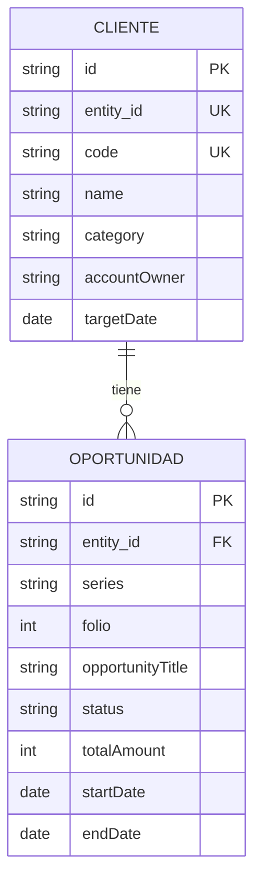

[data-model.md](https://github.com/user-attachments/files/34146454/data-model.md)
# Modelo de datos: módulo CRM

**Fecha**: 2026-10-29 · **Especificación**: [spec.md](spec.md)

## Decisión de adaptación

Se mantienen dos colecciones base: Entity representa Cliente y Document representa Oportunidad. Los nombres internos existentes permanecen estables. ModuleConfig es configuración estática; responsables y opciones son catálogos en esa configuración, sin una tercera tabla. No se usa una tabla separada de contactos: cada cliente tiene un contacto principal; múltiples contactos y actividades son extensiones futuras.

## Entidad: Cliente (Entity)

| Campo | Tipo | Significado CRM | Restricción |
|---|---|---|---|
| id | string | Identificador interno | Generado, único, inmutable |
| entity_id | string | Identificador público para vinculación | Generado, único, inmutable; no es code ni RUT |
| name | string | Nombre o razón social | Obligatorio, recortado, no vacío |
| code | string | Código de cliente | Obligatorio; único tras trim y mayúsculas |
| taxId | string | Identificación fiscal | Base opcional; no requerida en demo |
| email | string | Correo del contacto principal | Opcional; formato válido si existe |
| phone | string | Teléfono del contacto principal | Opcional, recortado |
| address | string | Dirección | Base opcional; no se solicita en el formulario CRM |
| category | string | Tipo de cliente | Obligatorio CRM: Prospecto, Activo, Inactivo |
| description | string | Contexto de la relación comercial | Opcional; texto seguro |
| targetDate | string | Próximo contacto | Opcional, fecha real YYYY-MM-DD |
| creditLimit | number | Límite de crédito | Base opcional ≥ 0; no se usa para priorización CRM |
| paymentTerms | string | Condiciones de pago | Base opcional, fuera del formulario CRM |
| contactName | string | Nombre del contacto principal | Personalizado, opcional |
| accountOwner | string | Ejecutivo responsable | Personalizado, obligatorio, catálogo |
| acquisitionSource | string | Origen de captación | Personalizado, obligatorio, catálogo |
| createdAt | string | Creación | ISO 8601, generado |
| updatedAt | string | Última modificación | ISO 8601, actualizado al guardar |

Se omiten del formulario CRM los campos comerciales base no necesarios, pero no se borran de registros existentes ni se reutilizan con otro significado. Se requiere ajustar la presentación si el template no permite ocultarlos desde configuración.

## Entidad: Oportunidad (Document)

| Campo | Tipo | Significado CRM | Restricción |
|---|---|---|---|
| id | string | Identificador interno | Generado, único, inmutable |
| entity_id | string | Cliente propietario | Obligatorio; referencia Entity.entity_id existente |
| series | string | Serie interna | CRM fija OPP al crear; no tiene validez tributaria |
| folio | number | Número interno de oportunidad | Obligatorio, entero > 0; pareja series/folio única global |
| startDate | string | Fecha de apertura | Obligatoria, fecha real YYYY-MM-DD |
| endDate | string | Fecha estimada de cierre | Obligatoria; ≥ startDate; puede quedar vencida |
| quantity | number | Cantidad base | Opcional, entero > 0; fuera del formulario CRM |
| subtotal | number | Importe base antes de impuestos | Opcional ≥ 0; fuera del formulario CRM |
| discount | number | Descuento base | Opcional ≥ 0 y ≤ subtotal si se informa; no usado en CRM |
| taxAmount | number | Impuesto base | Opcional ≥ 0; no usado en CRM |
| totalAmount | number | Monto comercial estimado | Obligatorio CRM, finito, entero ≥ 0, CLP |
| currency | string | Moneda | CRM fija CLP |
| paymentTerms | string | Condiciones comerciales base | Opcional; fuera del formulario CRM |
| notes | string | Contexto y resultado del último contacto | Opcional; no es historial auditable |
| status | string | Etapa comercial | Obligatorio; Nueva al crear; ciclo definido abajo |
| opportunityTitle | string | Asunto o necesidad comercial | Personalizado, obligatorio, no vacío |
| opportunityOwner | string | Responsable de esta negociación | Personalizado, obligatorio, catálogo |
| lossReason | string | Motivo de pérdida | Personalizado; obligatorio únicamente en Perdida |
| createdAt | string | Creación | ISO 8601, generado |
| updatedAt | string | Última modificación | ISO 8601, actualizado al guardar |

El monto estimado no es ingreso contable ni venta facturada. Los campos económicos opcionales de la base no se rellenan con valores ficticios ni se usan para recalcularlo. La oportunidad puede pertenecer a cualquier tipo de cliente; ganarla no cambia automáticamente category. El ejecutivo actualiza el tipo del cliente explícitamente.

## Catálogos y campos personalizados

Responsables de demostración: Ejecutivo A y Ejecutivo B. Orígenes: Sitio web, Referido, Contacto directo, Otro. La interfaz usa select para ambos y valida los valores en almacenamiento. No se guardan nombres reales en datos de ejemplo.

Los valores personalizados se almacenan junto a los campos base, con claves propias. Ninguna clave personalizada puede colisionar con campos base. `lossReason` requiere validación condicional de dominio; `required: true` no sería correcto porque impediría crear oportunidades abiertas.

## ModuleConfig

| Campo | Valor o decisión |
|---|---|
| moduleName | CRM — Comercial Andina Demo |
| labels | entity: Cliente; entities: Clientes; document: Oportunidad; documents: Oportunidades |
| customFields | contactName (entity/text/opcional), accountOwner (entity/select/obligatorio), acquisitionSource (entity/select/obligatorio), opportunityTitle (document/text/obligatorio), opportunityOwner (document/select/obligatorio), lossReason (document/text/opcional en esquema; condicionado por estado) |
| statusLifecycle | Estados y transiciones de la tabla siguiente |
| theme.accentColor | #0F766E |

Se conserva el contrato base de customFields: target, key, label, type, required y options cuando corresponda. Los campos base category, targetDate y totalAmount se adaptan mediante etiquetas y reglas CRM; no se redeclaran como customFields. El código fuente del template no fue aportado: se deberá comprobar qué etiquetas admite su cargador y añadir solamente los puntos de configuración que falten. No se afirma compatibilidad ejecutable sin esa verificación.

## Ciclo de vida de oportunidades

| Estado actual | Siguientes estados permitidos |
|---|---|
| Nueva | Contactada, Perdida |
| Contactada | Propuesta, Perdida |
| Propuesta | Negociación, Ganada, Perdida |
| Negociación | Ganada, Perdida |
| Ganada | Ninguno |
| Perdida | Ninguno |

Se permite guardar otros cambios conservando el estado actual. Se rechazan saltos no declarados. Entrar en Perdida exige motivo no vacío. No se permite elegir un estado final al crear ni reabrir oportunidades cerradas. Un registro malformado no se corrige silenciosamente.

## Relaciones e integridad

- Un Cliente tiene cero o muchas Oportunidades; cada Oportunidad pertenece a exactamente un Cliente.
- La clave de relación es Document.entity_id → Entity.entity_id. La aplicación impone la integridad porque localStorage no tiene claves foráneas.
- Eliminar un cliente, después de confirmar el alcance, elimina en cascada sus oportunidades.
- Eliminar una oportunidad no elimina al cliente. Editar nombre o código no modifica entity_id.
- Folio se introduce manualmente en el MVP; validar unicidad de serie/folio al crear y editar, excluyendo el registro actual.
- Códigos se comparan con trim y mayúsculas; conservar una representación normalizada para evitar duplicados.
- Correo no es una clave única: dos clientes pueden compartir un contacto.

## Persistencia, fechas y errores

Se mantiene el contrato de almacenamiento del repositorio base. Al disponer del código se debe identificar la clave y estructura exactas antes de modificarlas. No se inventa aquí una clave supuestamente existente. El repositorio de datos valida una instantánea completa en memoria y guarda la eliminación en cascada como una sola escritura de un agregado; si la base usa claves separadas, esta es una extensión necesaria para evitar escrituras parciales. El esquema CRM debe versionarse explícitamente y nunca migrar datos en silencio.

Las fechas son de calendario local YYYY-MM-DD; las marcas de tiempo usan ISO 8601. Se valida existencia del día en el mes. Para comparaciones de vencimiento usar una cadena construida con año, mes y día locales, sin convertir la fecha a UTC.

Ante JSON corrupto o cuota agotada se conserva la información previa y se muestra un error. Si otra pestaña cambia los datos, se detecta con storage y se evita guardar el formulario desactualizado hasta recargar; esto no equivale a soporte multiusuario.

## Variables e indicadores descriptivos

| Indicador | Regla exacta |
|---|---|
| Clientes registrados | Conteo de todos los clientes, incluidos prospectos e inactivos |
| Oportunidades abiertas | Conteo con status en Nueva, Contactada, Propuesta o Negociación |
| Monto abierto | Suma de totalAmount de oportunidades abiertas; CLP, sin ponderaciones |
| Seguimientos vencidos | Clientes category ≠ Inactivo y targetDate no vacío anterior a hoy local; un cliente cuenta una vez |
| Contactos para hoy | Clientes category ≠ Inactivo con targetDate igual a hoy local |
| Tasa de cierre | Ganadas / (Ganadas + Perdidas) × 100; mostrar Sin datos si el denominador es cero |

Los indicadores abarcan todos los registros actuales, sin ventana temporal. No son cifras de ventas de un período. El método es conteo, suma y proporción, sin estimación predictiva. Guardar la próxima fecha por cliente evita contar dos veces un seguimiento por múltiples oportunidades; no sustituye una agenda de actividades.

## Modelo entidad-relación

El diagrama resume las claves y variables centrales; las tablas anteriores contienen el esquema completo. series + folio es una restricción única compuesta. La imagen equivalente se entrega como modelo-entidad-relacion.svg.

## Evolución futura

Agregar tablas Usuario, Contacto y Actividad cuando exista backend, con autenticación, autorización y auditoría; migrar las referencias con identificadores estables. Incorporar API para compartir clientes con Ventas, evitando duplicar maestros. La interconexión actual es un contrato de datos propuesto, no una integración implementada. Incorporar históricos y métricas por período antes de comparar rendimiento; evaluar sesgos por calidad de registros y origen de captación.
