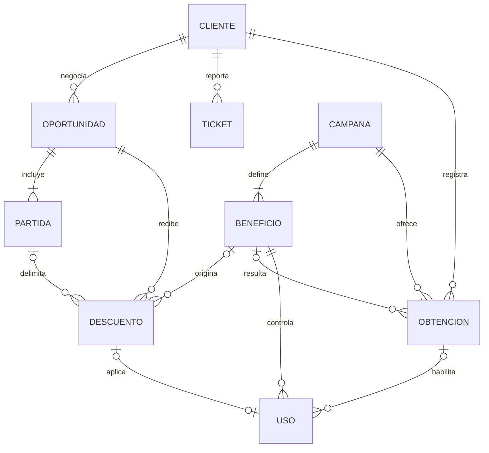

# Modelo para implementar campañas y descuentos

Estado propuesto. Este modelo extiende el [modelo vigente del CRM](../001-crm-module/data-model.md) y su [contrato de almacenamiento](../001-crm-module/contracts/entity-storage.md). Usar IDs estables. Un cambio de nombre, descripción o código visible no debe romper las relaciones.

| Registro | Identidad y campos esenciales | Reglas |
|---|---|---|
| Campaña | ID, código normalizado único, nombre, descripción, inicio, fin, habilitada, versión y marcas de tiempo | Vigencia calculada con fechas locales inclusivas. Desactivar conserva el historial. |
| Beneficio | ID, campaña, mecanismo, código de canje opcional, alcance, tipo/valor, elegibilidad, prioridad, compatibilidades y límites | Una campaña tiene uno o más. La dinámica define resultados, sus probabilidades y cupo de participación; el origen de la obtención queda registrado. Compatibilidad bilateral explícita entre campañas y con manuales. |
| Oportunidad | ID actual, `entity_id`, etapa, `baseAmount`, `totalAmount` | Conservar campos del CRM y CLP. Guardar total derivado como importe canónico usado por panel, listado y tablero; validarlo con el cálculo compartido antes de confirmar. |
| Partida | ID, oportunidad, descripción, producto externo opcional, cantidad y precio base CLP | Una o más por oportunidad en el esquema nuevo. Una referencia a producto no crea inventario. |
| Descuento aplicado | ID, oportunidad, partida opcional, origen, IDs de campaña/beneficio si aplica, motivo manual, fecha, orden, base afectada y monto descontado | Congelar tipo, valor, alcance, mecanismo, versión y condiciones de elegibilidad y combinación. Guardar y mostrar el desglose. Una edición del catálogo no revaloriza acuerdos anteriores. |
| Participación u obtención | ID, ID de operación, cliente, campaña, mecanismo, beneficio/resultado opcional y fecha | El resultado sin premio cuenta como participación. Un código o dinámica puede generar una obtención disponible. Una aplicación directa no inventa participación. |
| Uso | ID, cliente, beneficio, obtención opcional, oportunidad, partida opcional, estado y fechas | Una reserva activa por aplicación. Contar por partida o por oportunidad según alcance. Una obtención puede respaldar los usos permitidos por sus límites. La liberación registra qué uso se retiró. |

**Integración.** La Persona 1 mantiene el evaluador de condiciones y la Persona 2 mantiene el cálculo de importes. En la vista previa se invocan con el borrador. Al confirmar, la Persona 3 relee los datos vigentes dentro de la operación protegida, invoca esas mismas funciones y verifica la transición con las reglas existentes de `src/crm-rules.js`. Solo entonces guarda. Al editar una reserva existente, el evaluador descuenta del saldo ocupado la reserva propia que se está sustituyendo y evalúa la selección completa una sola vez. Consultar y previsualizar son operaciones de lectura. Participar escribe, incluso si el resultado es «sin beneficio».

**Persistencia.** En el esquema actual, `src/storage.js` escribe varias claves sucesivas y conserva copias en memoria para revertir errores. Para la nueva versión se propone una instantánea CRM versionada bajo una clave nueva, con un único punto de confirmación por operación. Todas las mutaciones del perfil CRM, incluidas las previas de clientes y tickets, deben usar la misma ruta. Serializar los escritores de pestañas del mismo origen con Web Locks; dentro del bloqueo releer la revisión, comprobar límites e idempotencia y confirmar con una sola escritura. Un formulario con revisión obsoleta conserva el borrador. Si el entorno carece de coordinación segura, ofrecer lectura y explicar cómo abrir la demo en un navegador compatible antes de reservar. Verificar que solo haya una versión de la app escribiendo durante la migración. [Estándar Web Storage](https://html.spec.whatwg.org/multipage/webstorage.html) · [Web Locks](https://developer.mozilla.org/en-US/docs/Web/API/Web_Locks_API)

**Migración.** Mostrar el alcance y solicitar confirmación según NFR-008. Leer el esquema previo, preservar sus claves mientras se valida el nuevo conjunto y publicar la versión nueva como una sola operación. La presencia de una instantánea nueva válida determina qué versión lee la app. Ante cuota insuficiente, corrupción o cancelación, conservar el original y explicar el resultado. Recuperar datos previamente corruptos requiere decisión explícita. La migración conserva campos históricos, tickets y oportunidades cerradas. Los importes válidos se trasladan a una partida de respaldo sin descuentos. Detectar la versión ya migrada antes de transformar. Aplicar solo al perfil CRM.

**Privacidad y bajas.** Desvincular datos de contacto del historial tras una eliminación. Para respetar cupos globales y evitar dobles consumos conservar los IDs internos, el beneficio, alcance, fecha, cantidad de usos y estado terminal. Si se restaura el mismo ID de cliente, recuperar su historial de límites. Crear un cliente con otro ID cuenta como otra identidad local; el prototipo no verifica personas entre cuentas, perfiles o dispositivos.

**Decisiones para validar en implementación.** Ante un empate de prioridad se ordena por ID estable. Los porcentajes se redondean al peso, con mitad hacia arriba, en cada paso. Rechazar operaciones con importes fuera del rango exacto. Para sorteos, inyectar en las pruebas la fuente del resultado y cubrir límites de intervalo y la opción sin beneficio. Ningún sorteo usa atributos personales o el monto de la cartera para ajustar probabilidades.

