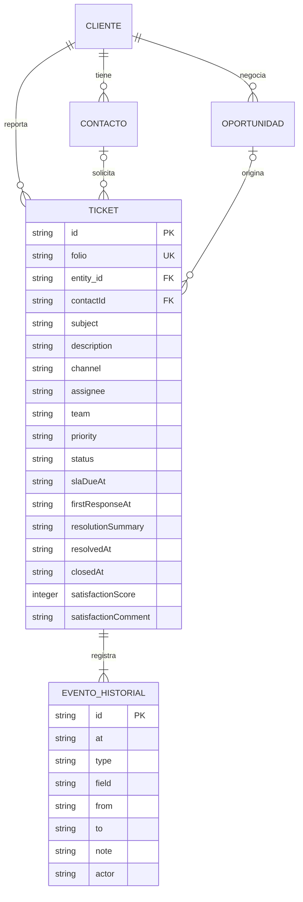

# Modelo de datos: ticket de post-venta completo

**Feature**: `004-ticket-postventa` | **Fecha**: 2026-11-28 | **Plan**: [plan.md](plan.md) | **Especificación**: [spec.md](spec.md) | **Modelo base**: [001-crm-module/data-model.md](../001-crm-module/data-model.md) | **Contrato**: [entity-storage.md](../001-crm-module/contracts/entity-storage.md)

## Alcance del modelo

Este documento describe la **ampliación aditiva** del ticket. No reemplaza el modelo de `001`: conserva `Entity` (cliente), `Document` (oportunidad), `Contact`, `Activity`, `TrashEntry` y sus relaciones. El ticket sigue siendo la única entidad persistida que se amplía; el historial es un valor embebido y no se crea una colección nueva. El esquema pasa de `SCHEMA_VERSION = 3` a `4`.

La fuente de verdad de los campos base sigue siendo `specs/001-crm-module/data-model.md`; durante la implementación se actualiza con esta ampliación. Los catálogos son configuración estática de demostración, no entidades transaccionales.

## Diagrama de relaciones



**Cardinalidades**:

- Un cliente tiene cero o muchos tickets; cada ticket pertenece a exactamente un cliente por `entity_id`.
- Un ticket puede referenciar cero o un contacto del mismo cliente (`contactId`). El ticket conserva una copia de respaldo aunque el contacto se elimine.
- Un ticket puede referenciar cero o una oportunidad del mismo cliente (`documentId`). Si la oportunidad se elimina, la referencia se conserva y se muestra como no disponible.
- Un ticket tiene uno o más eventos de historial; el historial no existe fuera del ticket.
- Un ticket puede tener como máximo un técnico asignado en esta iteración; la reasignación reemplaza al anterior y deja un evento.
- El producto es una referencia externa (`productId` o `productName`); no se crea catálogo ni inventario.

## Entidad: Ticket (ampliada)

| Campo | Tipo | Clasificación | Regla |
|---|---|---|---|
| `id` | string | Obligatorio, generado | Identidad técnica existente; prefijo `tkt`; no cambia. |
| `folio` | string | Obligatorio, generado, inmutable | `TKT-AAAA-####`; único global; asignado por almacenamiento y migración; no editable. |
| `entity_id` | string | Obligatorio | Cliente existente; no se reasigna. |
| `contactId` | string \| null | Opcional | Contacto del mismo cliente. Se conserva aunque el contacto se elimine; un valor nuevo inválido se rechaza. |
| `requesterName` | string \| null | Opcional | Respaldo del solicitante; copiado del contacto o ingresado. |
| `requesterEmail` | string \| null | Opcional | Correo válido cuando está presente. |
| `requesterPhone` | string \| null | Opcional | Texto no vacío cuando está presente. |
| `subject` | string | Obligatorio | Recortado, 1–120 caracteres; separado de la descripción. |
| `description` | string | Obligatorio | Descripción del caso; no vacía tras `trim`. |
| `productId` | string \| null | Opcional | Referencia externa; si existe, cadena no vacía. |
| `productName` | string \| null | Condicional | Se exige si no hay `productId` (regla vigente del CRM). |
| `equipmentReference` | string \| null | Opcional | Referencia del equipo; sin catálogo de inventario. |
| `warrantyEndsAt` | string (`YYYY-MM-DD`) \| null | Opcional | Fecha de calendario válida; no calcula cobertura. |
| `documentId` | string \| null | Opcional | Oportunidad o venta de origen del mismo cliente. |
| `reason` | string | Obligatorio | `soporte`, `reclamo` o `consulta`. |
| `channel` | string | Obligatorio en altas nuevas; opcional en históricos | Catálogo `channel`; en migrados ausentes se muestra “Canal no registrado”. |
| `priority` | string | Obligatorio | `Alta`, `Media` o `Baja`; congelada desde `Resuelto`. |
| `status` | string | Obligatorio | `Nuevo`, `En proceso`, `En espera`, `Resuelto` o `Cerrado`. |
| `assignee` | string \| null | Opcional | Técnico del catálogo; “Sin asignar” cuando falta. |
| `team` | string \| null | Opcional | Equipo o cola del catálogo; “Sin asignar” cuando falta. |
| `slaDueAt` | string ISO 8601 | Derivado | `createdAt + objetivo(priority)`; materializado como dato informativo y recalculado en cada lectura. Nunca se acepta del usuario. |
| `firstResponseAt` | string ISO 8601 \| null | Generado | Se asigna la primera vez que el ticket abandona `Nuevo`; no editable; no se inventa en la migración. |
| `resolutionSummary` | string \| null | Condicional | Obligatorio para resolver un ticket nuevo; no puede contener solo espacios. |
| `resolvedAt` | string ISO 8601 \| null | Generado | Lo asigna el sistema al resolver; inmutable después. |
| `closedAt` | string ISO 8601 \| null | Generado | Lo asigna el sistema al cerrar; inmutable. |
| `satisfactionScore` | integer 1–5 \| null | Opcional | Solo al resolver o mientras está `Resuelto`; se registra una sola vez; inmutable en `Cerrado`. |
| `satisfactionComment` | string \| null | Opcional | Hasta 500 caracteres tras `trim`; texto seguro. |
| `history` | array de eventos | Obligatorio | Append-only; todo ticket v4 tiene al menos una entrada. |
| `legacyResolutionIncomplete` | boolean | Solo migración | Marca tickets históricos resueltos sin resumen o sin `resolvedAt` verificable; no editable. |
| `createdAt` | string ISO 8601 | Obligatorio, generado | Se conserva; es la base del SLA y del folio. |
| `updatedAt` | string ISO 8601 | Obligatorio, generado | Se actualiza en cada escritura. |

**Campos eliminados o renombrados**: ninguno. `reason`, `priority`, `productId`, `productName`, `equipmentReference`, `resolutionSummary`, `resolvedAt` y `legacyResolutionIncomplete` se conservan con su significado actual.

La **fecha de registro de la satisfacción** no se agrega como campo: se obtiene del `at` del evento `satisfaccion` más reciente del historial. Así se evita duplicar un dato que ya es append-only y se conserva la fecha aunque la nota se registre en el diálogo de resolución.

## Entidad embebida: Evento de historial

```text
TicketHistoryEvent {
  id,      // string único y estable dentro del ticket: `${ticket.id}:${n}`
  at,      // ISO 8601 generado por el sistema
  type,    // creacion | estado | prioridad | asignacion | equipo |
           // resolucion | cierre | satisfaccion | migracion
  field,   // opcional: campo afectado cuando corresponde
  from,    // opcional: valor anterior serializable
  to,      // opcional: valor nuevo serializable
  note,    // opcional: detalle legible (por ejemplo, motivo de espera)
  actor    // opcional: técnico del catálogo o "Sistema"
}
```

Reglas:

- Se agrega al final; no se edita ni se elimina.
- Se escribe en la misma instantánea que el cambio del ticket.
- El orden de presentación es descendente por `at` y desempata por el orden de inserción.
- `actor` es el técnico asignado vigente o `"Sistema"`; no se inventa una identidad autenticada.
- El historial es de solo lectura desde la interfaz.
- La eliminación del ticket elimina también su historial porque está embebido.

**Eventos por operación**:

| Operación | Evento(s) |
|---|---|
| Alta | `creacion` con folio asignado. |
| Cambio de estado | `estado` con `from`, `to` y, si aplica, `note` de espera. |
| Cambio de prioridad | `prioridad` con `from`, `to` y recálculo de SLA. |
| Reasignación de técnico | `asignacion` con `from`, `to`. |
| Cambio de equipo | `equipo` con `from`, `to`. |
| Resolución | `resolucion` con fecha y resumen legible; no duplica el texto completo si ya está en `resolutionSummary`. |
| Cierre | `cierre` con fecha y estado anterior. |
| Satisfacción | `satisfaccion` con nota y comentario opcional. |
| Migración | `migracion` con la fecha real y nota de que no se reconstruyeron datos. |

## Catálogos de configuración

| Catálogo | Valores iniciales | Uso |
|---|---|---|
| `channel` | `Teléfono`, `Correo`, `WhatsApp`, `Presencial`, `Portal` | Origen del caso; obligatorio en altas nuevas. |
| `assignee` | `Técnico A`, `Técnico B`, `Técnico C` | Técnico asignado; opcional. |
| `team` | `Soporte técnico`, `Terreno`, `Repuestos` | Equipo o cola; opcional. |
| `reason` | `soporte`, `reclamo`, `consulta` | Motivo; vigente. |
| `priority` | `Alta`, `Media`, `Baja` | Prioridad; vigente. |

Los catálogos son listas estáticas de `ModuleConfig`; no representan cuentas autenticadas, permisos ni turnos. Un valor persistido que deje de existir en el catálogo se conserva y se advierte; al editar se exige una nueva selección.

## Máquina de estados

| Desde | Hacia permitido |
|---|---|
| `Nuevo` | `En proceso` |
| `En proceso` | `En espera`, `Resuelto` |
| `En espera` | `En proceso`, `Resuelto` |
| `Resuelto` | `Cerrado` |
| `Cerrado` | — (terminal) |

Cualquier otra combinación se rechaza, incluidos `Nuevo → Resuelto`, `Nuevo → Cerrado`, `En espera → Nuevo` y cualquier salida desde `Cerrado`.

**Reglas por estado**:

- `Nuevo`: recién creado; `resolvedAt` y `closedAt` vacíos; admite edición, asignación y prioridad.
- `En proceso`: admite espera, resolución, edición, asignación y prioridad.
- `En espera`: nota opcional; el SLA sigue corriendo; admite reanudar o resolver.
- `Resuelto`: exige `resolutionSummary` y `resolvedAt`; solo avanza a `Cerrado`; admite editar asunto, descripción, solicitante, canal, equipo, garantía y vínculo de origen; no admite prioridad, solución, fechas ni reasignación de técnico; la satisfacción se registra con la operación específica.
- `Cerrado`: solo lectura; conserva solución, fechas e historial.

## Validaciones

### Identificación y contenido

- `folio`: generado, formato `TKT-AAAA-####`, único en toda la colección, inmutable. Si el correlativo anual supera 9999, se rechaza el alta.
- `subject`: obligatorio, recortado, 1–120 caracteres. No reemplaza la descripción.
- `description`: obligatoria y no vacía.
- `entity_id`: debe existir al crear y al actualizar; no hay tickets huérfanos.
- `productId` o `productName`: al menos uno debe estar informado; se conserva la regla vigente.

### Referencias

- `contactId`: opcional; si se informa como valor nuevo, debe existir y pertenecer al mismo `entity_id`. Si ya estaba persistido y el contacto se eliminó, se conserva con advertencia.
- `requesterEmail`: válido si está presente.
- `requesterPhone`: texto no vacío si está presente.
- `channel`: obligatorio en altas nuevas; si está presente, debe pertenecer al catálogo. En tickets migrados puede faltar y se muestra “Canal no registrado”.
- `assignee` y `team`: opcionales; si están presentes, deben pertenecer a su catálogo.
- `documentId`: opcional; si se informa como valor nuevo, debe existir y pertenecer al mismo cliente. Si el documento se elimina después, la referencia se conserva y se muestra “Venta de origen no disponible”.
- `warrantyEndsAt`: fecha real `YYYY-MM-DD` si está presente; no se calcula cobertura.

### Ciclo de vida y satisfacción

- Los tickets nuevos comienzan en `Nuevo`; los históricos conservan su estado.
- Solo se aceptan las transiciones de la tabla.
- Resolver exige `resolutionSummary` no vacío y genera `resolvedAt`.
- Cerrar genera `closedAt`; `Cerrado` es terminal.
- `firstResponseAt` se genera la primera vez que se abandona `Nuevo`; no se acepta del usuario.
- La prioridad se congela desde `Resuelto`.
- `satisfactionScore`: entero 1–5; `satisfactionComment`: hasta 500 caracteres; solo al resolver o en `Resuelto`; se registra una sola vez; inmutable en `Cerrado`.
- La eliminación exige confirmación y borra solo el ticket y su historial; el cliente y sus otras relaciones permanecen.

### Integridad por versión

- **v4 estricta**: folio válido y único, asunto no vacío, historial con al menos una entrada, estado dentro de los cinco permitidos, referencias opcionales válidas cuando están presentes.
- **v3 tolerante**: acepta la ausencia de folio, asunto, historial, `channel`, `assignee`, `team`, `firstResponseAt`, `closedAt` y satisfacción; valida lo existente. Permite leer para mostrar el aviso de migración, pero no escribir.
- Un ticket `Resuelto` v3 sin resumen o sin `resolvedAt` verificable se marca `legacyResolutionIncomplete = true` durante la migración.

## Valores derivados

### SLA

| Prioridad | Objetivo desde `createdAt` | Umbral “Por vencer” |
|---|---|---|
| `Alta` | 24 horas | 6 horas restantes o menos |
| `Media` | 72 horas | 18 horas restantes o menos |
| `Baja` | 168 horas (7 días) | 42 horas restantes o menos |

```text
slaDueAt = createdAt + SLA_HOURS_BY_PRIORITY[priority]

ahora >= slaDueAt                         → Vencido
0 < slaDueAt - ahora <= 25% del objetivo  → Por vencer
resto                                     → En plazo
```

- `slaDueAt` se materializa al guardar y en la migración, pero la lectura usa `createdAt` y `priority`; no se acepta como entrada.
- Para `Resuelto`/`Cerrado`: `resolvedAt <= slaDueAt` → `En plazo`; `resolvedAt > slaDueAt` → `Vencido`; sin `resolvedAt` verificable → `Sin datos`.
- `En espera` no pausa el SLA. No hay horarios laborales, feriados ni automatizaciones.
- El semáforo se comunica con texto e icono, no solo con color.

### Indicadores

| Indicador | Fórmula | Sin datos |
|---|---|---|
| Tickets abiertos | Conteo de tickets con estado `Nuevo`, `En proceso` o `En espera`. | `0` |
| Tickets vencidos de SLA | Conteo de tickets abiertos con `now >= computeSlaDueAt(createdAt, priority)`. | `0` |
| Tickets por prioridad | Conteo de abiertos por `Alta`, `Media` y `Baja`; se muestran los tres valores, incluidos los ceros. | Tres valores en `0` |
| Tiempo medio de resolución | Promedio de `(resolvedAt - createdAt)` en horas sobre fechas válidas; una cifra decimal. | `null` → “Sin datos” |
| Cumplimiento de SLA | `resueltos dentro del objetivo / resueltos con SLA calculable × 100`; una cifra decimal. | `null` → “Sin datos” |
| Satisfacción promedio | Promedio de `satisfactionScore` válidos (1–5); una cifra decimal. | `null` → “Sin datos” |

Reglas:

- `Resuelto` y `Cerrado` no cuentan como abiertos ni como vencidos abiertos.
- El cumplimiento usa el objetivo vigente al resolver; la prioridad no cambia después de `Resuelto`.
- Las fechas inválidas o ausentes se excluyen; no se imputan valores.
- Los indicadores comerciales y de actividades existentes se conservan y calculan con sus fórmulas vigentes.
- No se persisten agregados; el panel y la ficha recalculan en cada render.

## Persistencia

### Claves

| Clave | Contenido | Versión |
|---|---|---|
| `erp_base_module:entities` | Clientes | Existente |
| `erp_base_module:documents` | Oportunidades | Existente |
| `erp_base_module:tickets` | Tickets ampliados | Existente, forma v4 |
| `erp_base_module:crmContacts` | Contactos | Existente |
| `erp_base_module:crmActivities` | Actividades | Existente |
| `erp_base_module:crmTrash` | Papelera | Existente |
| `erp_base_module:crmRecovery` | Marcador de recuperación | Existente |
| `erp_base_module:schemaVersion` | Versión del esquema | Existente; pasa a 4 |
| `erp_base_module:crmBackup:v3` | Respaldo de la instantánea previa a migrar; el metadato `schemaVersion` registra la versión real de origen | **Nueva** |

### Invariantes

- La instantánea completa (seis colecciones) se valida antes de escribir.
- Un cambio de ticket, su historial y su versión se confirman juntos o no se confirman.
- `saveSnapshot` conserva una versión recuperable previa y restaura los valores anteriores si la escritura falla.
- Las escrituras se bloquean mientras la versión almacenada sea menor que 4.
- El respaldo de migración no se borra automáticamente; `restoreMigrationBackup()` es explícito y validado.
- Eliminar un ticket no elimina al cliente, sus oportunidades, contactos ni actividades.
- La papelera de clientes no se amplía: la eliminación de un ticket es definitiva y no usa la papelera.
- Los valores desconocidos de catálogos se conservan y se advierten.

## Migración v3 → v4

### Mapeo de campos

| Campo v4 | Origen en v3 | Regla |
|---|---|---|
| `folio` | No existe | Se asigna por año local de `createdAt`, ordenando por `createdAt` ascendente y desempatando por `id`; correlativo anual de cuatro dígitos. |
| `subject` | No existe | Se copia la descripción recortada a 120 caracteres; no se inventa un asunto nuevo. |
| `contactId`, `requesterName`, `requesterEmail`, `requesterPhone` | No existen | `null`; la interfaz muestra “Solicitante no registrado”. |
| `channel` | No existe | `null`; la interfaz muestra “Canal no registrado”. |
| `assignee`, `team` | No existen | `null`; “Sin asignar”. |
| `warrantyEndsAt` | No existe | `null`; “Garantía no registrada”. |
| `documentId` | No existe | `null`; sin vínculo de origen. |
| `slaDueAt` | No existe | Se calcula si `createdAt` y `priority` son válidos; no se altera `createdAt`. |
| `firstResponseAt` | No existe | `null`; no se infiere. |
| `closedAt` | No existe | `null`; ningún ticket v3 está cerrado. |
| `satisfactionScore`, `satisfactionComment` | No existen | `null`; no se inventan. |
| `history` | No existe | Se agrega una entrada `migracion` con la fecha real y nota de no reconstrucción. |
| `status` | Existente | Se conserva (`En proceso` o `Resuelto`). |
| `resolutionSummary`, `resolvedAt`, `legacyResolutionIncomplete` | Existentes | Se conservan; si `Resuelto` no tiene resumen o fecha verificable, se marca `legacyResolutionIncomplete = true`. |
| `createdAt`, `updatedAt`, `id`, `entity_id`, `productId`, `productName`, `equipmentReference`, `reason`, `description`, `priority` | Existentes | Se conservan sin cambios. |

### Protocolo

1. Leer la instantánea v3 completa y la versión almacenada.
2. Construir la instantánea v4 en memoria; abortar antes de escribir si un `createdAt` es inválido o si un folio no puede asignarse.
3. Escribir `erp_base_module:crmBackup:v3` con `{ createdAt, schemaVersion: <versión de origen>, collections, ticketCount }`; si no hay cuota, abortar sin modificar nada. La clave conserva el nombre `crmBackup:v3` por contrato y el metadato registra la versión real.
4. Escribir las colecciones transformadas y verificar folio único, asunto e historial en todos los tickets, y que clientes, oportunidades, contactos, actividades y papelera no hayan cambiado.
5. Escribir `schemaVersion: 4` solo después de la verificación.
6. Si cualquier paso falla, restaurar desde el respaldo y conservar `schemaVersion: 3`.

**Garantías**:

- Cancelar conserva la versión 3 y no habilita escrituras incompatibles.
- El respaldo no se borra automáticamente y se puede restaurar de forma explícita.
- Los tickets migrados no reciben soluciones, cierres, técnicos, canales ni satisfacción inventados.
- Los tickets abiertos migrados pueden aparecer `Vencido` porque su fecha de creación es real; es un resultado veraz.
- La migración no modifica clientes, oportunidades, contactos, actividades ni papelera, salvo el marcador de versión.
- Los tickets migrados sin `firstResponseAt` no se consideran inválidos.

## Ejemplo de ticket v4

```json
{
  "id": "tkt_001",
  "folio": "TKT-2026-0042",
  "entity_id": "ent_001",
  "contactId": "con_002",
  "requesterName": "María Pérez",
  "requesterEmail": "maria.perez@example.com",
  "requesterPhone": "+56 9 1234 5678",
  "subject": "Compresor no arranca tras corte de energía",
  "description": "El equipo quedó detenido después del corte y no responde al reinicio.",
  "productId": null,
  "productName": "Compresor industrial 50 HP",
  "equipmentReference": "CMP-2024-018",
  "warrantyEndsAt": "2027-03-31",
  "documentId": "doc_010",
  "reason": "soporte",
  "channel": "Teléfono",
  "priority": "Alta",
  "status": "Resuelto",
  "assignee": "Técnico B",
  "team": "Soporte técnico",
  "slaDueAt": "2026-11-29T14:00:00.000Z",
  "firstResponseAt": "2026-11-28T14:30:00.000Z",
  "resolutionSummary": "Se reemplazó el fusible de control y se verificó el arranque.",
  "resolvedAt": "2026-11-28T18:20:00.000Z",
  "closedAt": null,
  "satisfactionScore": 5,
  "satisfactionComment": "Atención rápida y clara.",
  "history": [
    {
      "id": "tkt_001:1",
      "at": "2026-11-28T14:00:00.000Z",
      "type": "creacion",
      "note": "TKT-2026-0042",
      "actor": "Técnico B"
    },
    {
      "id": "tkt_001:2",
      "at": "2026-11-28T14:30:00.000Z",
      "type": "estado",
      "field": "status",
      "from": "Nuevo",
      "to": "En proceso",
      "actor": "Técnico B"
    },
    {
      "id": "tkt_001:3",
      "at": "2026-11-28T18:20:00.000Z",
      "type": "resolucion",
      "field": "status",
      "from": "En proceso",
      "to": "Resuelto",
      "note": "Se reemplazó el fusible de control y se verificó el arranque.",
      "actor": "Técnico B"
    },
    {
      "id": "tkt_001:4",
      "at": "2026-11-28T18:25:00.000Z",
      "type": "satisfaccion",
      "field": "satisfactionScore",
      "to": 5,
      "actor": "Sistema"
    }
  ],
  "legacyResolutionIncomplete": false,
  "createdAt": "2026-11-28T14:00:00.000Z",
  "updatedAt": "2026-11-28T18:25:00.000Z"
}
```

## Fuera del modelo

No se agregan entidades para producto, inventario, facturación, garantías, adjuntos, notificaciones, base de conocimiento, permisos, turnos ni respaldos administrados. Tampoco se agrega una colección de historial ni un log global. Estas ideas quedan como trabajo futuro en `spec.md`.
